# BE THE FIREWORK

*A shell's four seconds, from the only impossible seat.*

[](https://be-the-firework.vercel.app)
[](https://threejs.org)
[](#faq)
[](LICENSE)

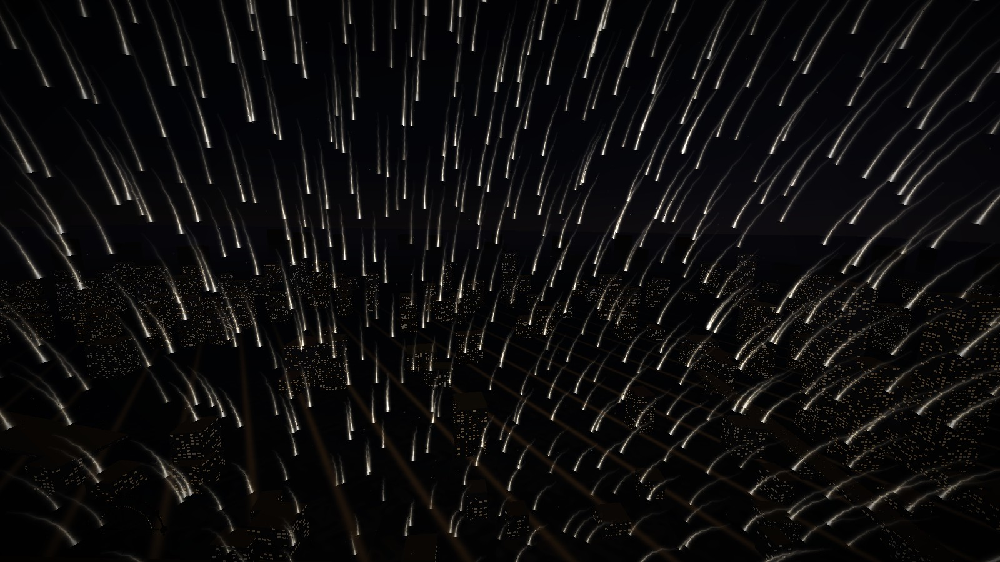

**▶ [be-the-firework.vercel.app](https://be-the-firework.vercel.app)**

You are the shell. Not the spectator.

The camera sits inside the mortar for one held breath, gets thrown up a three-second climb over a
harbour festival, and detonates — and then the camera *is* the bloom, hanging at the centre of a
ten-thousand-star cathedral of streamers as they unfurl, curve into gravity, crackle and die around
you, before falling softly with the last embers into the next launch.

No menus, no titles, no camera shake bolted onto a particle demo. Everything below is one HTML file
and a pinned Three.js.

---

## The ride

| | Beat | What you feel |
|---|---|---|
| 1 | **In the tube** (~1 s) | Near-darkness inside the mortar. A circle of night sky over the lip, crowd-glow bleeding down the steel, the fuse flickering warm on the wall. One held breath. |
| 2 | **Ignition** | A floor of white-gold fire, streaks racing up the walls, and the camera is thrown upward. |
| 3 | **The climb** (~3 s) | Violent initial acceleration easing into a coast. Look down: your own lifting-charge tail sparking away, the mortar flash receding, the harbour unfolding — promenade crowd as glittering dots, city light smeared on black water, other shells rising on glowing threads. |
| 4 | **Apex hush** | The roar fades visually, the spin slows, the city is far below and the stars are close. Then the burst charge fires. |
| 5 | **The burst, in three beats** | One frame of blinding gold → a translucent pressure ring racing outward through the smoke → the bloom: thousands of tracked embers erupting radially with luminous ribbon trails, the camera floating at the exact centre of an expanding golden sphere. |
| 6 | **The hold** | Inside the bloom in gentle slow motion. Streamers comb over into gravity's direction, the inner surface glitters and breathes, crackle-stars micro-burst, smoke veils are lit from within, the city glows through falling gold below. Embers cool white-gold → amber → dying red, trails thin, everything decelerates into drift. |
| 7 | **The fall** | The camera descends softly among the last embers and smoke, over the water. |
| 8 | **The next shell** | A breather: drifting through smoke, the crowd-glow rising, a mortar flash below, the whistle of ascent. Then it starts again. |

---

## Screenshots

All captured from the live build at 1600×900 — real frames, no composites, no post-processing,
no overlays removed after the fact.

### 01 · In the tube
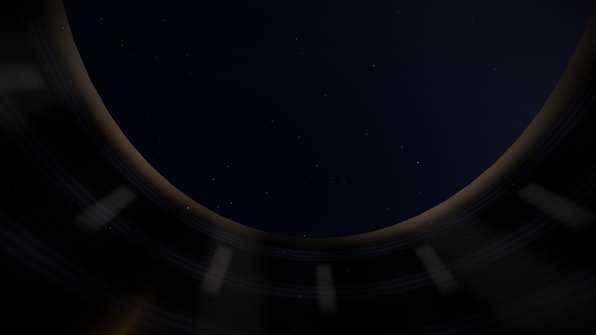

The circle of sky over the lip. Rivets catching the crowd glow, the fuse warm in the corner,
stars already sharp above.

### 02 · Ignition
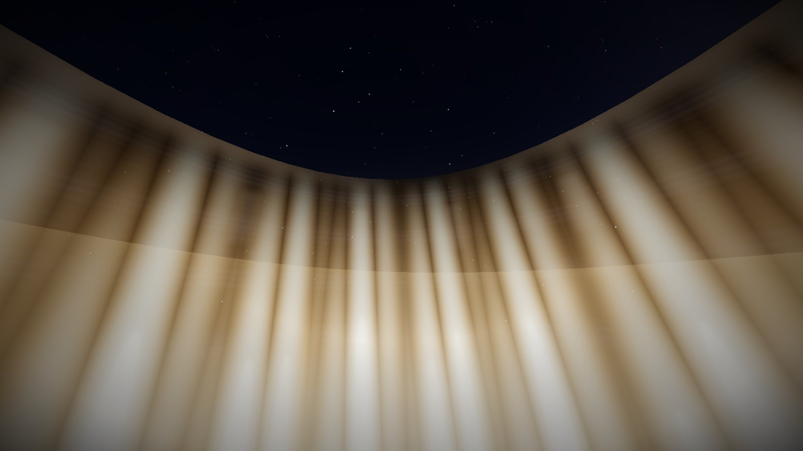

A floor of white-gold fire climbing the walls, streaks racing up the steel, the lip falling away —
the last frame from inside the mortar.

### 03 · The climb
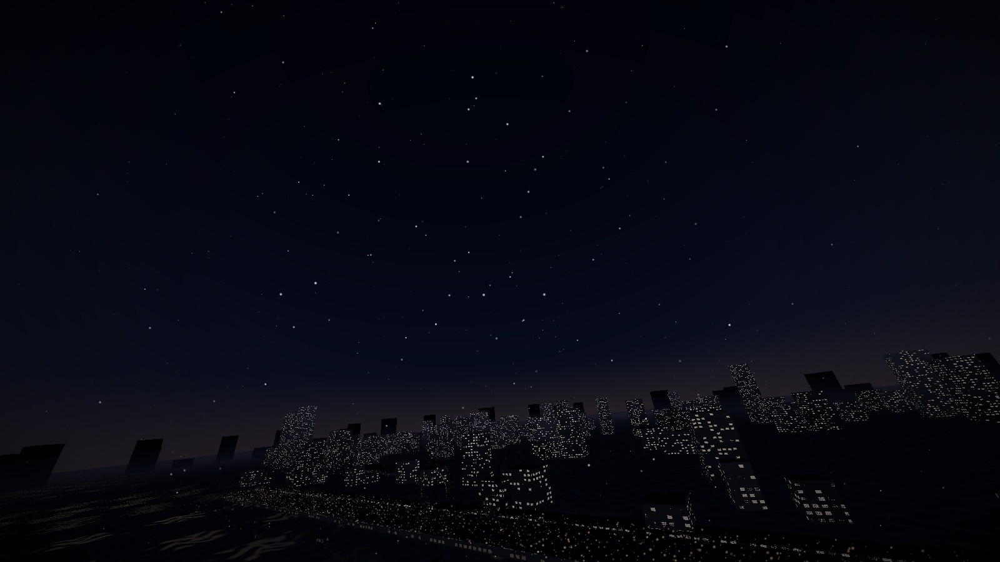

Looking down the climb: your own sparking lifting-charge tail, the mortar flash receding, the
harbour laid out as light on black water.

### 04 · Apex hush
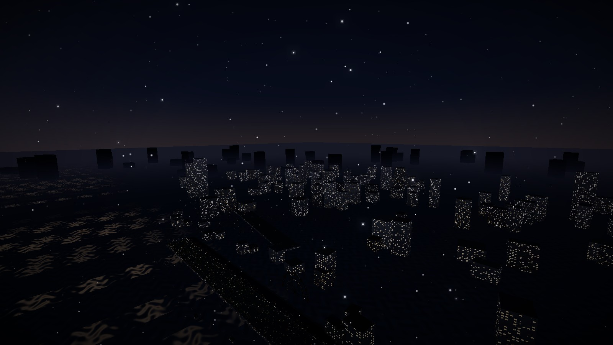

The moment before the break. Spin slowed, roar gone visual, city far below, stars close.

### 05 · Bloom
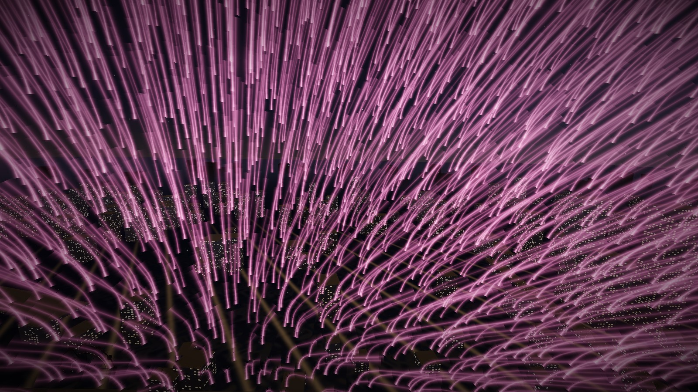

The camera at the exact centre of the expanding sphere. Every ember here is an individually tracked
body with its own flicker frequency, colour temperature and ribbon trail.

### 06 · Crossette, second generation
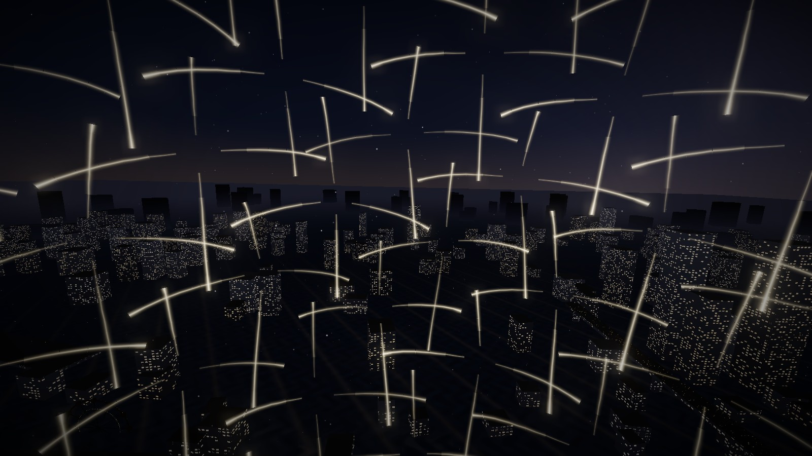

The stars split into four, and the second generation bursts *around* the camera.

### 07 · Ring shell
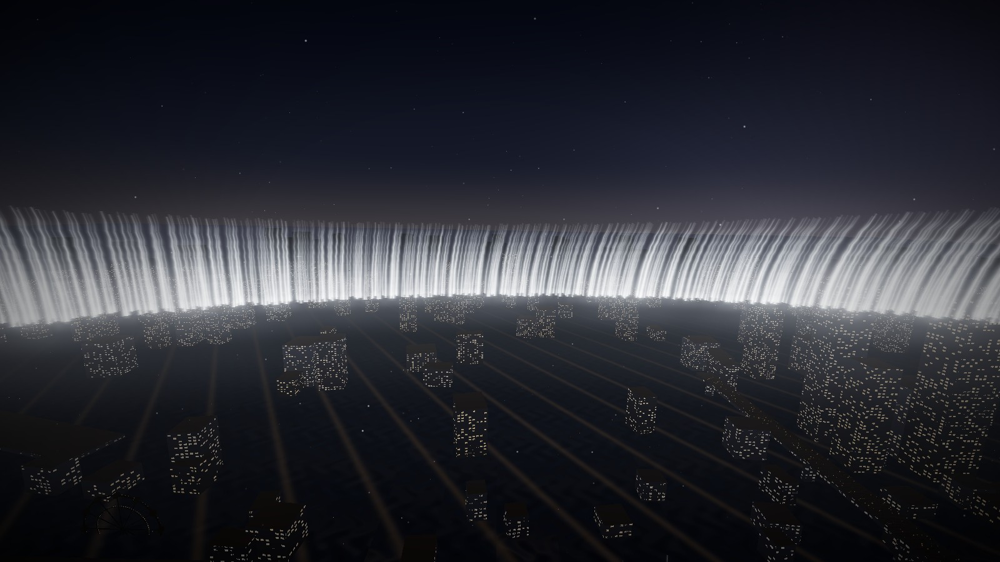

A Saturn-like halo with the camera on the axis, looking down its throat.

### 08 · Golden willow, from below
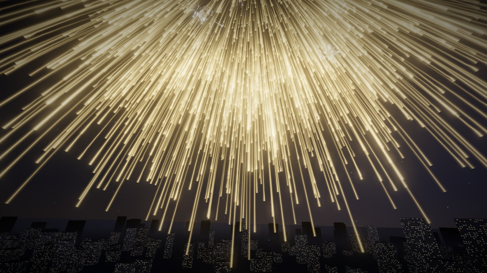

The only seat below the shell: looking up through the droop as the streamers comb over into gravity.

### 09 · The promenade
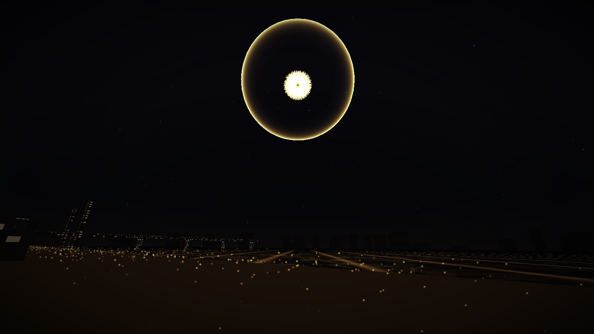

The only outside seat. Upturned faces as warm dots, the shell's light strobing across them, the
shock ring passing overhead.

### 10 · Grand finale
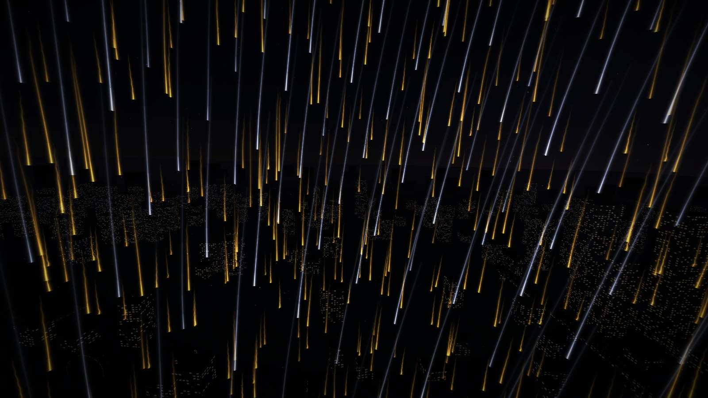

Triple-break shell: three nested bursts with the camera at the heart of all three.

---

## The repertoire

| Shell | What it does |
|---|---|
| **Golden willow** | Low-expansion gold embers with long, soft, drooping trails — the classic "it hangs in the air" shell. |
| **Chrysanthemum** | Dense symmetric radial burst, tinted from a palette of amber / gold / ruby / emerald / magenta / blue / white. |
| **Palm** | A few thick fronds that break up into staggered second-generation fans. |
| **Crossette** | Stars that split into four on cue, the second generation bursting around the camera. |
| **Ring** | A ring shell: Saturn-like halo viewed down the axis, camera at the centre. |
| **Strobe** | Synchronised silver blinking — every star phases together. |
| **Finale** | Triple break: three nested shells, camera at the heart of all three. |

Auto-cycle order: `willow → chrysanthemum → palm → crossette → ring → strobe → willow →
chrysanthemum → crossette → strobe → ring → finale`, then round again. Two-beat breather between
rides.

---

## Controls

Compact by design — the show starts at ignition, so the HUD only fades in after the first burst.

| Control | Effect |
|---|---|
| **Time** (hero slider) | Time dilation, real-time ×1 → deep slow ×15, where the bloom becomes a full minute and free-flying through it is the point |
| **Shell** | Auto-cycle, or pin one type |
| **Cadence** | Brisk / Festival / Drift — the length of the breather between rides |
| **Quality** | High / Medium / Low — ember count, trail segments, smoke layers, crowd dots |
| **Free-fly** (`F`) | Full movement inside the bloom: WASD, Q/E, Shift to boost, drag to look |
| **Photo** (`P`) | Letterboxed, HUD hidden — clean frames |
| **Reset** (`R`) | Back into the tube for a fresh launch |
| **Sound** | Procedural WebAudio: the whistle, the thump, the crackle (off until you click) |

### Presets

`Tube` · `Apex` · `Bloom` · `Crossette` (second generation) · `Halo` (ring seat) · `Willow ↓`
(below the golden droop, looking up) · `Crowd` (the promenade — the only outside seat, one full shell).

---

## Why it looks the way it does

- **Embers are analytic, not simulated.** One `InstancedBufferGeometry`; every ember is `segs`
  ribbon quads. Position is integrated *in the vertex shader* from
  `p0 + v0·((1−e^{−kt})/k) + g·t′`, so a ten-thousand-star bloom costs zero per-frame CPU work and
  the whole thing scrubs perfectly at any time-dilation setting.
- **Trails are camera-facing ribbons.** The side vector is `cross(velocity, viewRay)`, width tapers
  along the segment, `headFlare` widens only the head, and a two-frequency wobble keeps the strands
  from reading as cones.
- **Choreography is precomputed per shell type** at load — willow, chrysanthemum, palm, crossette,
  ring, strobe and the finale are patterns, not live simulation, so the shape is the shape at any
  frame rate.
- **The city is merged geometry with one shader**: a procedural window grid, per-building seed, and
  a `uFlash` uniform that lights every facade from the shell's direction with correct flash-lag
  darkness afterwards. The crowd is instanced point sprites lit by the same uniform.
- **Smoke is layered billboards** that grow, rise and are lit from within, and it persists across
  rides as drifting strata the next launch climbs through.
- **Post**: `UnrealBloomPass` (0.52 / 0.80 / 0.78) + ACES tone mapping at 0.92 exposure,
  devicePixelRatio clamped to 2.
- **Quality degrades in the right order**: ember counts, trail segments, smoke layers and crowd
  dots shrink first; choreography, dilation smoothness and the launch sequence are never touched.
  `fpsEMA` auto-steps the tier down once if a ride starts under 34 fps.

---

## Run it locally

ES modules and import maps need HTTP, so serve the folder rather than opening the file:

```bash
python3 -m http.server 8080
# → http://localhost:8080/index.html
```

No build step, no install, no dependencies to fetch beyond the pinned Three.js r169 module from
jsDelivr. `index.html` is the whole experience: CSS, HTML shell, import map, and one ES module.

**Self-hosted / offline?** Vendor the module instead and swap the two import-map entries:

```
"three":          "./vendor/three.module.js",
"three/addons/":  "./vendor/addons/"
```

---

## Deployment

Live on Vercel at **[be-the-firework.vercel.app](https://be-the-firework.vercel.app)**. The recipe —
including the exact `projectSettings` a files-based Vercel deployment needs — is in
**[docs/deployment.md](docs/deployment.md)**. `tools/build.sh` regenerates the minified deploy
artifact from `index.html`.

---

## FAQ

**Is this a firework video?**
No. It is a real-time WebGL scene. Nothing is pre-rendered; every ember in every screenshot is
computed on the GPU that frame.

**Are those screenshots enhanced?**
They are unedited frames from the live build, captured at 1600×900 with the HUD hidden. The colours
are the scene's own — the chrysanthemum palette is randomised per shell, which is why the same shell
type shows up gold in one capture and magenta in another.

**Why can't I just double-click `index.html`?**
Import maps and ES modules require an HTTP origin. `file://` will show the "In the tube" splash and
stop. Use any static server.

**Does it need a GPU?**
It needs WebGL2. It runs on integrated graphics at High on a modern laptop; if a ride starts below
34 fps the quality tier steps itself down once automatically.

**Is there sound?**
Yes — procedural WebAudio (ascent whistle, launch thump, burst crackle), generated with oscillators
and noise buffers, no audio files. It stays muted until you click or press a key, because browsers
require a gesture.

**What is the honest time scale?**
The burst is played at 1/dilation. At ×1 you get the real four violent seconds; at ×15 the bloom is
a full minute of drift, which is where free-fly becomes interesting.

**Can I use the code?**
MIT. See [LICENSE](LICENSE).

---

## Repository layout

```
index.html                  the entire experience — CSS, shell, import map, one ES module
screenshots/                unedited 1600×900 captures from the live build
tools/build.sh              rebuilds the minified deploy artifact
tools/capture-screenshots.mjs  the Puppeteer harness that produced screenshots/
docs/                       deployment notes, physics + tuning notes per subsystem
.github/workflows/pages.yml GitHub Pages deployment
```

---

MIT © [sarang-cmd](https://github.com/sarang-cmd)
